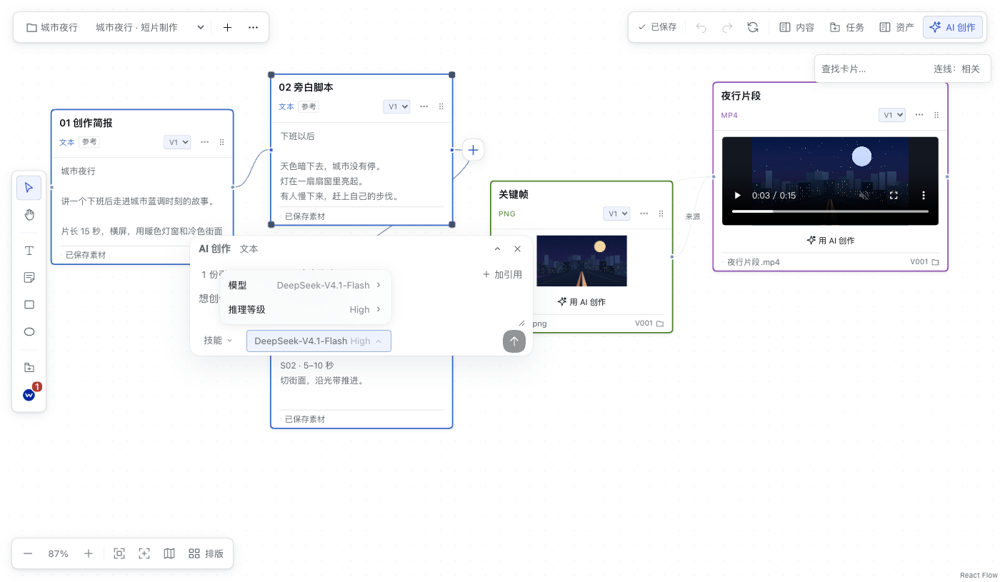

# WTT 创作工作台

WTT 创作工作台（`@wtt/dsh-creation-workbench`）是 DeepSeek Harness（DSH）的开源插件。把创作流程放进一张可操作的画布，从资料和脚本推进到 PPT、镜头片段和成品。每一步都能单独调整，也能交给 WTT 项目助手组织执行。

## 核心功能

以下截图来自同一个「城市夜行」演示项目。

### 可视化创作工作流

把项目素材、提示词、中间成果、任务和最终文件放到同一张画布。可以从单张卡片发起创作。框选多张卡后点「＋」，可以把它们一起作为下一步的引用，再选择要生成的卡片类型。连线能回看成果的来源，卡片保留各次生成或手动修改的版本。


### PPT 制作

把资料、提案结构和逐页大纲做成上游卡片，再引用它们创建 PPT 任务。交付的 PPTX 可以在画布里逐页预览和下载。需要调整时，可基于选定版本继续对话并保存新版。有关联编辑源稿的课件可以打开源稿，已有 PPTX 也可下载后用本机应用修改。


### 视频制作与模型选择

把脚本、分镜、参考画面和镜头片段分成节点。生成视频时可以直接引用上游关键帧，片段回到画布后可以播放、拖动进度和继续引用。修改某一镜时，从对应节点生成新版，再用选定的片段继续后续工作。

模型可以按任务切换。发起脚本、分镜等卡片任务时，可从 DSH 已配置的模型中选择模型和推理等级。已创建的任务保留当时的选择。图片和视频卡还可以用本机 Skill，或切换到已配置的媒体 API 选择对应模型。自定义连接可指定服务地址、兼容协议和模型 ID，支持的比例、时长和参考图随模型能力而定。



### WTT 项目助手

点击画布左侧的 W 图标，用一次对话交代整个目标，例如「根据现有分镜制作镜头样片，再整理成发布提案」。这是对主 Agent 和子 Agent 协作的一次尝试。项目助手负责规划和跟进，可按步骤依赖把工作派到同一项目的不同画布。每个子任务有自己的 DSH 卡片对话，可以查看进度、处理提问、接管某一步，再把选定的成果版本交回助手。

默认先规划后执行。可以在对话里核对步骤、引用和目标画布，再直接授权。切换画布可以续聊；在助手顶部点「新建对话」，可从当前画布另开会话。项目记忆和委托可继续查阅。


### 项目文件栏

在左侧「文件」栏按文件名或相对路径查找，用 Shift 连选，或用 Ctrl / ⌘ 逐项选择。可以把多份文件拖到画布，或在创作时一次加入引用。预览素材时可固定右侧预览，继续在文件树里查找。

从右键菜单打开原件。选中的文件可用右键菜单或快捷键重命名、剪切、复制、粘贴，也可以拖到目标目录。遇到同名文件时可跳过或保留副本。通过文件栏的「撤销」可以恢复上一笔整理。

## 从一张画布开始

1. 选一个本机文件夹作为项目，新建画布，把项目文件拖进去，或新建文本卡记录想法。
2. 单击卡片正文或点卡片旁的「＋」发起 AI 创作。在「加引用 → 从画布选择」点选或完整框选卡片，多选后点「完成」；也可用 `@` 快速查找。按需用 `/` 选择本机 Skill。
3. 在右栏审阅成果，双击文本卡可直接编辑。需要继续迭代时，把修改保存成新版本。

任务开始后仍可补充参考资料：在对话输入框上方点「画布资产」，选中卡片后点「完成」，再发送消息。[追加资产与隐藏对话](plugins/dsh-creation-workbench/README.md#在任务对话中追加画布资产)

## 安装

在 DSH 中打开 **插件 → 添加插件 → 安装第三方插件**，粘贴以下安装串：

```text
github:WaterDJiang/wtt-dsh-plugin#path:/plugins/dsh-creation-workbench
```

也可以在「发现」添加 [WTT 插件索引](https://raw.githubusercontent.com/WaterDJiang/wtt-dsh-plugin/main/market/index.json)。需要兼容的 DSH 宿主，具体范围见[插件安装说明](plugins/dsh-creation-workbench/README.md#安装)。

## 已安装？如何检查更新

当前版本 **0.58.7**。[更新日志](CHANGELOG.md)

保存编辑并等任务结束后，打开 **插件 → 发现 → WTT 创作工作台 → 更新**。看到「新版本已经开始运行」即可回到画布。DSH 明确提示「需要重启」时，再按提示操作。

从社区市场安装的用户可打开 **插件 → 插件市场 → 已安装**，在工作台条目点 **立即更新**。旧安装串迁移和回退方法见下方。

WTT 创作工作台已加入社区公共目录。各镜像的同步进度可能不同。[查看收录记录](https://github.com/awesome-dsh-plugin/awesome-dsh-plugin/pull/13878)

[按原安装来源升级、验证和回退](plugins/dsh-creation-workbench/README.md#检查更新与升级)

## 项目文件

| 项目 | 入口 |
| --- | --- |
| 插件源码、安装与运行说明 | [plugins/dsh-creation-workbench](plugins/dsh-creation-workbench) |
| 可选流程示例（课程开发） | [examples/course-workflow.md](examples/course-workflow.md) |
| DSH 自定义插件索引 | [market/index.json](market/index.json) |
| 维护与发布 | [发布检查清单](RELEASING.md) |

许可证为 [MIT](LICENSE)。
