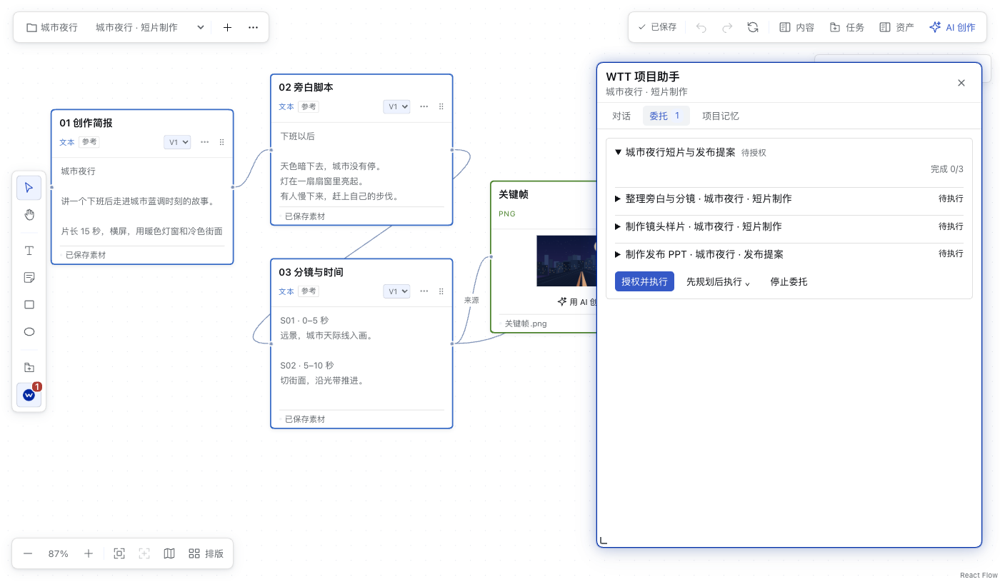
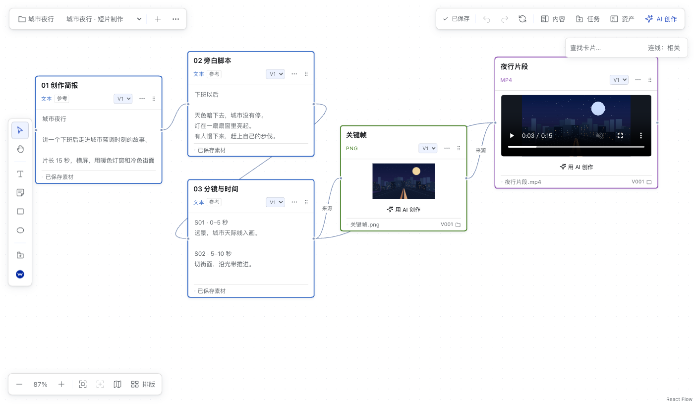
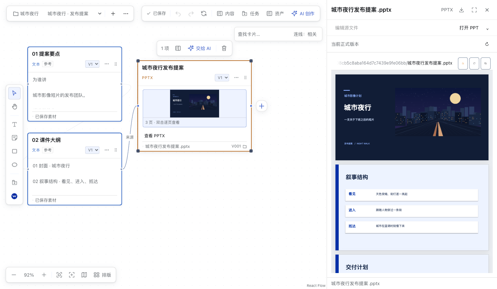

# WTT DSH 插件

| 插件 | 用途 |
| --- | --- |
| [WTT 创作工作台](plugins/dsh-creation-workbench/) | 用 AI 画布组织项目、资料和创作成果 |
| [WTT 股票分析](plugins/dsh-wanalysis/) | 在本机 SQLite 看 A 股行情、试算指标、查看归档财务 |

两个插件可以分别安装。[WTT 插件市场索引](market/index.json) · [股票分析安装指南（DSH 桌面入口、发现、社区市场、CLI、本地包）](https://github.com/WaterDJiang/wtt-dsh-plugin/tree/main/plugins/dsh-wanalysis#安装到-dsh)

## WTT 创作工作台

## 0.59.4-rc.1 候选版本

小瓦的 Codex 文本报告由 DSH 进程服务启动。它使用本机 Codex 的登录态，在临时目录以只读模式执行。以前仅通过环境变量 API Key 使用 Codex 的用户，可先在本机登录 Codex，或在授权前选用 DSH 模型。普通文档转换和预览使用单独的环境变量白名单。

微信扫码和图片、视频 API 继续集成在同一个工作台插件中。执行这些功能时，工作台会取用相应的微信令牌或媒体服务密钥。早期即梦连接仍兼容本机保存的 sessionId。

侧栏与面板统一使用小瓦标识。当前稳定版为 0.59.3。

WTT 创作工作台（`@wtt/dsh-creation-workbench`）是 DeepSeek Harness（DSH）的开源 AI 画布，可整理资料、制作 PPT、图片和视频。把跨画布的创作、验收和修订交给 **小瓦 · WTT 项目助手**（Super Agent），也可扫码连接 **微信 Bot**，在手机上向小瓦交代任务、确认计划和查看成果。

## 核心功能

以下截图来自同一个「城市夜行」演示项目。

<a name="wtt-项目助手"></a>

### 小瓦

在画布左侧「添加素材」下方点 W，把目标交给小瓦，例如「整理访谈、写提案，再做成 PPT」。助手会拆解目标，按依赖把步骤派到同一项目的不同画布。你可以在「委托」查看全过程，打开原任务对话、处理提问或接管某一步。

- **验收后继续**　给步骤写明验收条件和所需成果数。助手检查正式成果，按反馈在原卡修订，把通过验收的版本交给后续步骤。
- **逐步选择模型或执行者**　授权前在每步右侧选择 DSH 模型和推理等级。本机安装并配置 Codex CLI 后，也能把已授权的文本步骤交给 Codex。
- **在原画布查看成果**　从「委托」可定位卡片及版本。切换画布后可继续原对话，也能在当前画布新建对话。



### 微信 Bot

打开「画布菜单 → 微信连接小瓦」，用本人微信扫码。连接后打开 ClawBot 私聊，说「小瓦，你好」。

- **选项目和画布**　说「换个项目」「换张画布」或「新建一张叫访谈提纲的画布」。
- **确认计划和查成果**　直接交代任务，核对计划后回「按这个做」，进展可以问「刚才那个做好了吗」。

微信 Bot 支持本人私聊文字，需要 DSH 宿主运行。成果始终写入委托里约定的画布。 [连接与使用说明](plugins/dsh-creation-workbench/README.md#微信连接小瓦)

### 可视化创作工作流

把项目素材、提示词、中间成果、任务和最终文件放到同一张画布。可以从单张卡片发起创作。框选多张卡后点「＋」，可以把它们一起作为下一步的引用，再选择要生成的卡片类型。连线能回看成果的来源，卡片保留各次生成或手动修改的版本。



### PPT 制作

把资料、提案结构和逐页大纲做成上游卡片，再引用它们创建 PPT 任务。交付的 PPTX 可以在画布里逐页预览和下载。需要调整时，可基于选定版本继续对话并保存新版。有关联编辑源稿的课件可以打开源稿，已有 PPTX 也可下载后用本机应用修改。



### 视频制作与模型选择

把脚本、分镜、参考画面和镜头片段分成节点。生成视频时可以直接引用上游关键帧，片段回到画布后可以播放、拖动进度和继续引用。修改某一镜时，从对应节点生成新版，再用选定的片段继续后续工作。

模型可以按任务切换。发起脚本、分镜等卡片任务时，可从 DSH 已配置的模型中选择模型和推理等级。已创建的任务保留当时的选择。图片和视频卡还可以用本机 Skill，或切换到已配置的媒体 API 选择对应模型。自定义连接可指定服务地址、兼容协议和模型 ID，支持的比例、时长和参考图随模型能力而定。


### 项目文件栏

在左侧「文件」栏按文件名或相对路径查找，用 Shift 连选，或用 Ctrl / ⌘ 逐项选择。可以把多份文件拖到画布，或在创作时一次加入引用。预览素材时可固定右侧预览，继续在文件树里查找。

从右键菜单打开原件。选中的文件可用右键菜单或快捷键重命名、剪切、复制、粘贴，也可以拖到目标目录。遇到同名文件时可跳过或保留副本。通过文件栏的「撤销」可以恢复上一笔整理。

## 从一张画布开始

1. 选一个本机文件夹作为项目。在空画布点「添加素材」，或直接拖入第一份文件。
2. 导入后光标会进入卡旁输入框。写下要求并发送，素材会随任务一起引用。需要更多资料时，用 `@` 选择卡片或文件，用 `/` 选择本机 Skill。
3. 在卡片上查看任务进度和成果。选择要修改的版本，点「基于此版修改」继续创作。

任务开始后仍可补充参考资料：在对话输入框上方点「画布资产」，选中卡片后点「完成」，再发送消息。[追加资产与隐藏对话](plugins/dsh-creation-workbench/README.md#在任务对话中追加画布资产)

## 安装时的权限提示

「会用你的密钥」涉及几种不同的操作。普通文本对话由 DSH 处理认证；媒体 API 会用相应密钥向你选择的服务请求模型或生成内容；微信绑定后会用 Bot 令牌收发消息。0.59.3 中，已授权的本机 Codex 步骤也可能使用环境变量里的模型密钥。

市场列出的文件读写和命令执行用于导入、保存、预览和运行任务。若看到 `schemas.openxmlformats.org` 的 HTTP 提示，工作台在解析 Office 文件时用这个名称识别文档结构，解析本身无需联网。自定义局域网 HTTP 媒体服务则会实际使用未加密连接。[查看全部提示、数据去向和关闭方式](plugins/dsh-creation-workbench/README.md#安装时的权限提示)

## 安装

在 DSH 中打开 **插件 → 添加插件 → 安装第三方插件**，粘贴以下安装串：

```text
github:WaterDJiang/wtt-dsh-plugin#path:/plugins/dsh-creation-workbench
```

也可以在「发现」添加 [WTT 插件索引](https://raw.githubusercontent.com/WaterDJiang/wtt-dsh-plugin/main/market/index.json)。需要兼容的 DSH 宿主，具体范围见[插件安装说明](plugins/dsh-creation-workbench/README.md#安装)。

## 已安装？如何检查更新

当前版本 **0.59.3**。[更新日志](CHANGELOG.md)

保存编辑并等任务结束后，打开 **插件 → 发现 → WTT 创作工作台 → 更新**。看到「新版本已经开始运行」即可回到画布。DSH 明确提示「需要重启」时，再按提示操作。

从社区市场安装的用户可打开 **插件 → 插件市场 → 已安装**，在工作台条目点 **立即更新**。旧安装串迁移和回退方法见下方。

WTT 创作工作台已加入社区公共目录。各镜像的同步进度可能不同。[查看收录记录](https://github.com/awesome-dsh-plugin/awesome-dsh-plugin/pull/13878)

[按原安装来源升级、验证和回退](plugins/dsh-creation-workbench/README.md#检查更新与升级)

## 项目文件

| 项目 | 入口 |
| --- | --- |
| 插件源码、安装与运行说明 | [plugins/dsh-creation-workbench](plugins/dsh-creation-workbench) |
| 可选流程示例（课程开发） | [examples/course-workflow.md](examples/course-workflow.md) |
| DSH 自定义插件索引 | [market/index.json](market/index.json) |
| 维护与发布 | [发布检查清单](RELEASING.md) |

许可证为 [MIT](LICENSE)。
