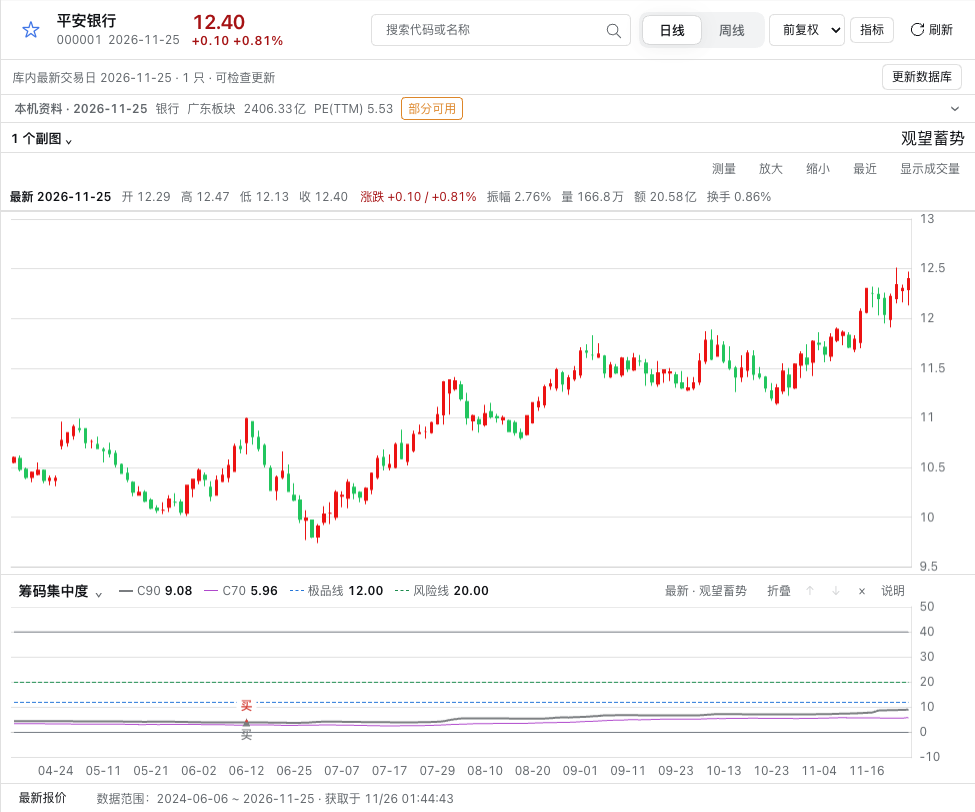

# WTT 股票分析

在 DeepSeek Harness（DSH）侧栏打开 **WTT 股票分析**，搜索一只 A 股，把行情同步到本机 SQLite，就能离线切换日线、周线，查看筹码集中度和已归档财报。



## 安装到 DSH

第一次安装，直接使用 **方式一**。已经在 DSH 添加过 WTT 创作工作台索引的用户，可以直接用 **方式二** 搜索股票分析。两者安装同一个公开插件，任选一种即可。

### 方式一 · DSH 官方桌面入口

打开 **插件 → 添加插件 → 安装第三方插件**，粘贴整行并确认安装：

```text
github:WaterDJiang/wtt-dsh-plugin#path:/plugins/dsh-wanalysis
```

末尾的 `plugins/dsh-wanalysis` 指定股票分析子包。同一个 GitHub 仓库也提供创作工作台。

### 方式二 · DSH 官方「发现」

在 **插件 → 实验性插件** 中启用 **自定义插件索引**（部分版本称「自定义插件市场」）。进入 **发现 → 添加索引源**，粘贴：

```text
https://raw.githubusercontent.com/WaterDJiang/wtt-dsh-plugin/main/market/index.json
```

刷新后搜索 **WTT 股票分析**，点开详情，选择兼容版本并安装。已经添加过 WTT 索引时只需刷新。同一个索引内的两个插件可以分别安装、更新。[DSH 官方插件索引指南](https://github.com/deepseek-ai/deepseek-harness/blob/master/docs/user/guide/plugin-market.zh.md)

### 方式三 · 社区插件市场 dshmarket

在已安装 dshmarket 的 DSH 中打开 **插件 → 插件市场**。社区收录并同步到所用目录后，搜索 **WTT 股票分析** 即可安装。暂时搜不到时，可以直接使用方式一或二。[查看社区收录进度](https://github.com/awesome-dsh-plugin/awesome-dsh-plugin/pull/19113)

### 方式四 · DSH 官方命令行

桌面版先打开一次 DeepSeek Harness 以初始化配置，再完全退出应用。执行以下命令后重新打开桌面版：

```sh
dsh plugin --profile desktop add 'github:WaterDJiang/wtt-dsh-plugin#path:/plugins/dsh-wanalysis'
```

使用 DSH Web 版时，安装到 Web 配置：

```sh
dsh plugin --profile web add 'github:WaterDJiang/wtt-dsh-plugin#path:/plugins/dsh-wanalysis'
```

要精确复现某个版本，可从市场索引的股票分析条目取该版本的 `source.commit`。例如公开版 0.5.2 对应以下安装串，在方式一或 CLI 均可使用：

```text
github:WaterDJiang/wtt-dsh-plugin#93ab8b850e3f870984578c29a377c5c06ebc739d&path:/plugins/dsh-wanalysis
```

### 方式五 · 从本地安装包安装

公开仓已经包含构建产物。有 Git 和 npm 的机器可以从股票子目录打包：

```sh
git clone --depth 1 https://github.com/WaterDJiang/wtt-dsh-plugin.git
cd wtt-dsh-plugin/plugins/dsh-wanalysis
npm pack --ignore-scripts
```

将生成的 `.tgz` 复制到目标电脑。在安装包所在目录执行下方命令（文件名以实际生成的为准）。Web 版将 `desktop` 换为 `web`。

```sh
dsh plugin --profile desktop add "$PWD/wtt-dsh-wanalysis-0.5.2.tgz"
```

### 安装后第一次打开

按宿主提示完成加载或重启，从左侧栏进入 **WTT 股票分析**。首次打开会在当前 DSH 配置下创建本机行情库。已有 Wanalysis v3 行情库的用户可点击顶部路径选回原文件。搜索 **000001 平安银行**，点 **更新数据库 → 同步这只股票**，即可查看本机日线。

## 用平安银行试一次

- **搜股票**　在搜索框输入 `000001` 或「平安银行」，点选结果。
- **取行情**　点 **更新数据库 → 同步这只股票**。看到该股的交易日期和 K 线后，切到 **周线**。想建立整个市场的归档，可在同一面板选 **同步全部 A 股**。
- **加副图**　点 **指标 → 算法库 → 筹码集中度**。移动十字线，可对照同一天的价格和指标值。成交量也可单独开启。
- **查财报**　展开图表上方的 **本机资料**，看最新已归档财报的报告期和公告日。

[看图操作指南](docs/first-chart.md) · [数据库、模型与常见问题](docs/data-and-support.md)

## 检查更新

**更新行情**用看盘页的 **更新数据库**。**升级插件**用社区市场的 **已安装 → 立即更新**（有新版时显示）。通过 GitHub 安装的用户可在原 DSH 配置中重新安装同一来源，按提示重启，核对顶部数据库路径。

**0.5.2** 已迁入 WTT 插件合集。原先通过独立仓安装的用户可以在同一个 DSH 配置用上面的安装串覆盖安装，或从新的合集索引更新。包名和本机数据库配置沿用原值。

0.5.1 调整了桌面指标面板的高度，让短列表的操作按钮紧跟指标；补齐公开版图解和市场预览。包名为 `@wtt/dsh-wanalysis`，兼容宿主范围见 package.json。

[版本记录](CHANGELOG.md) · [第三方组件与声明](THIRD_PARTY_NOTICES.md)
