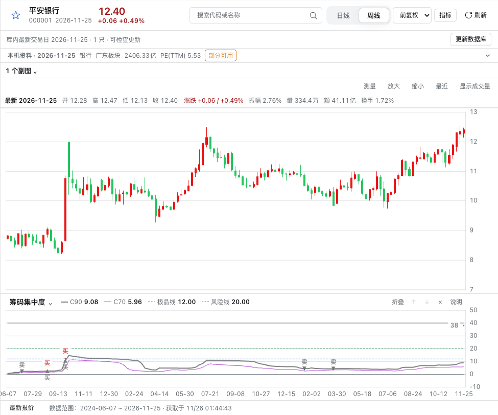
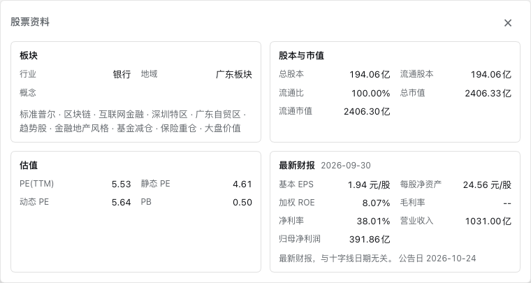

# 第一次看盘：平安银行

以下截图来自 DSH 中的公开版，示例库只同步了平安银行。截图上的日期代表这次归档；使用时以自己库里的日期为准。

## 建库并同步一只股票

第一次打开侧栏的 **WTT 股票分析** 后，顶部会显示本次打开的 SQLite 路径。直接使用新库即可。若有旧库，点路径，选择 **浏览文件…**，打开原来的 Wanalysis v3 行情数据库。

在顶部搜索 `000001` 或「平安银行」，确认股票名称和代码。点开搜索结果，后台会自动更新这只股票。如果打算离线使用，先在联网时完成这一步。

需要手动刷新或下载全市场时，可打开 **更多同步选项**。

## 切到周线

日线出现后，点顶部的 **周线**。周线使用已归档日线聚合。移动十字线，图表上方显示所选周期的开、高、低、收；底部显示可用数据范围。点 **显示成交量** 可加上成交量。

## 打开筹码集中度

点 **指标 → 算法库**，勾选 **筹码集中度**，关闭面板即可查看副图。再次点同一项可取消。公开版随包提供这一个指标；在 **我的** 中可以管理自己保存的公式。

自己的公式也可以加入副图，最多同时展开五张。拖第一张副图的上边缘会调整整组高度；拖两张副图之间的分隔线只调整相邻两张。双击分隔线可恢复默认比例。

## 阅读归档财务

展开 **本机资料**，可查行业、股本、市值、估值和最新财报。示例中，行情更新到 11 月 25 日，财报报告期是 9 月 30 日，公告日是 10 月 24 日。移动 K 线十字线时，财务面板仍展示最新已归档的报告。缺失字段显示为双横线。

[返回安装说明](../README.md) · [同步全市场与故障处理](data-and-support.md)
